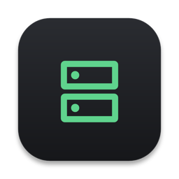
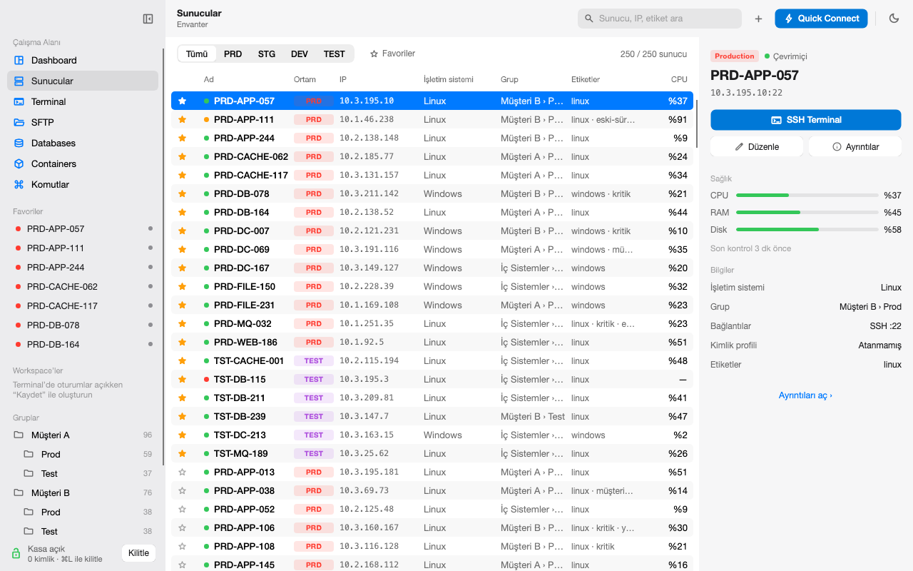
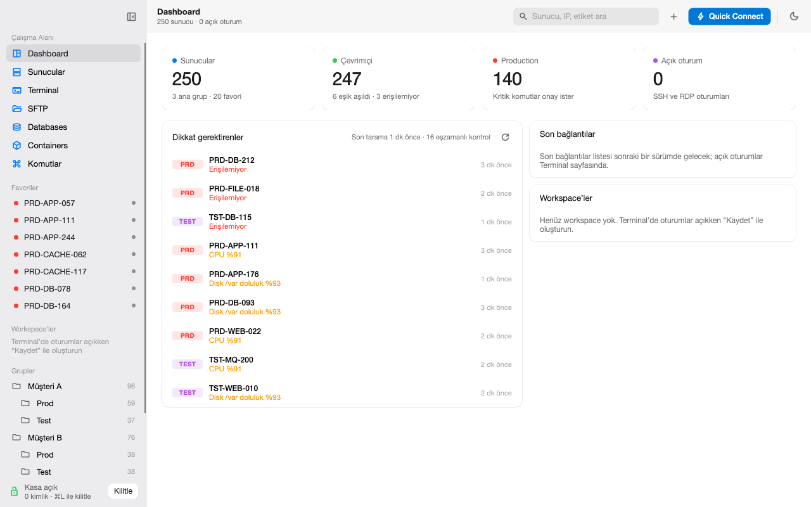
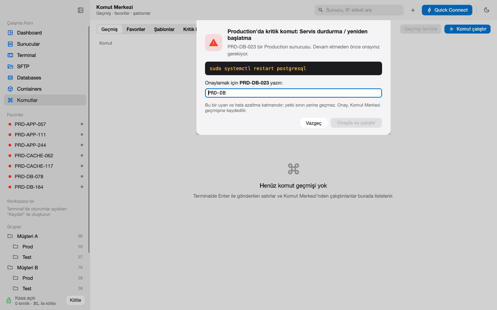
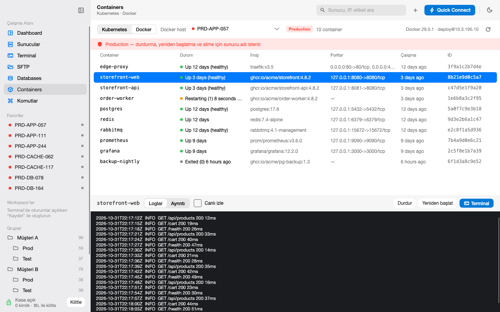
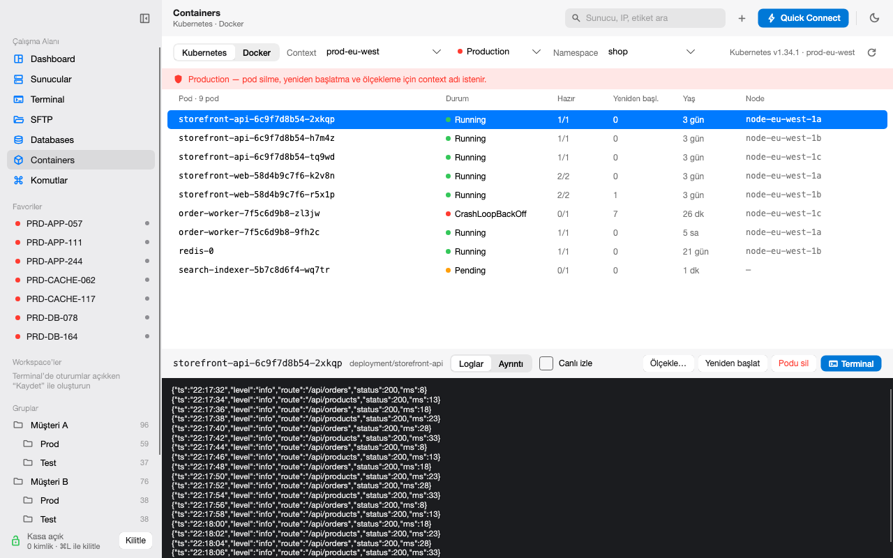

# ServerDesk

**One desk for every server you run.** 
SSH, RDP, SFTP, databases, Docker and Kubernetes in one native app for macOS and Windows, with your secrets in an encrypted vault and guard rails on Production.

 

&nbsp;

[Features](#features) · [Security](#security) · [Install](#install) · [All releases](https://github.com/osmanarabaci/ServerDesk-releases/releases) · [Türkçe](README.tr.md)

 

<picture>
  <source media="(prefers-color-scheme: dark)" srcset="docs/images/servers-dark.png">
  
</picture>

## Features

| | |
|---|---|
| **Inventory** | Hundreds of servers in groups, with tags, favorites, environments (Production, Staging, Development, Test) and instant search. Import from `~/.ssh/config` or CSV, export to CSV. |
| **Terminal** | SSH sessions in tabs with a full xterm terminal, split view and workspaces you can save and restore. |
| **Remote Desktop** | RDP sessions built in, through bundled FreeRDP. |
| **SFTP** | Two-pane file transfer with drag and drop. Every transfer is checked with SHA-256 and size, and conflicts are asked about. |
| **Command Center** | Run saved and templated commands, keep a history, and catch critical commands before they run. |
| **Health** | Agentless CPU, RAM and disk readings over SSH (Linux) and WinRM (Windows), with 24 hours of history. |
| **Databases** | SQL Server, PostgreSQL and MySQL, connected directly or through an SSH tunnel. Read-only by default. |
| **Docker** | Containers on any SSH host: logs, details, start, stop, restart, remove and a shell inside. |
| **Kubernetes** | Contexts from your kubeconfig: pods, logs, rollout restart, scaling and a pod terminal. |
| **Fast to drive** | Recent connections, a right-click menu on every server, and keyboard shortcuts for tabs, search and the server list (<kbd>⌘/</kbd> shows them all). |

<table>
  <tr>
    <td width="50%">
      <picture>
        <source media="(prefers-color-scheme: dark)" srcset="docs/images/dashboard-dark.png">
        
      </picture>
      
<b>Dashboard</b>: what needs attention, at a glance

    </td>
    <td width="50%">
      <picture>
        <source media="(prefers-color-scheme: dark)" srcset="docs/images/critical-dark.png">
        
      </picture>
      
<b>Guard rails</b>: type the server name to run a critical command on Production

    </td>
  </tr>
  <tr>
    <td width="50%">
      <picture>
        <source media="(prefers-color-scheme: dark)" srcset="docs/images/docker-dark.png">
        
      </picture>
      
<b>Docker</b> over SSH, no agent on the host

    </td>
    <td width="50%">
      <picture>
        <source media="(prefers-color-scheme: dark)" srcset="docs/images/kubernetes-dark.png">
        
      </picture>
      
<b>Kubernetes</b> straight from your kubeconfig

    </td>
  </tr>
</table>

## Security

- **Encrypted vault.** Passwords, SSH keys and passphrases live in one portable file, encrypted with AES-256-GCM under a key derived with Argon2id. The same vault opens on macOS and Windows.
- **Locks itself.** <kbd>⌘L</kbd> / <kbd>Ctrl+L</kbd> locks the vault, and it also locks after a quiet spell, when the Mac sleeps or when the screen locks. Nothing that needs a secret runs while it is locked.
- **Trust on first use.** SSH host keys, RDP certificates and database certificates are shown once and pinned in the vault. A changed key stops the connection and tells you why.
- **Production guard rails.** Critical commands (`rm -rf`, `shutdown`, `systemctl restart`, `DROP`, …) and destructive actions on Production servers, containers and clusters ask you to type the server name first.
- **Read-only by default.** Database sessions start read-only, and changes are rolled back until you turn it off.

> [!NOTE]
> These are warning and error-reduction layers. They do not replace access control on the servers themselves.

## Install

| Platform | Package |
|---|---|
| macOS (Apple Silicon) | [`ServerDesk-osx-arm64-Setup.pkg`](https://github.com/osmanarabaci/ServerDesk-releases/releases/latest/download/ServerDesk-osx-arm64-Setup.pkg): installs into `~/Applications`, no administrator password |
| Windows 10/11 (x64) | [`ServerDesk-win-x64-Setup.exe`](https://github.com/osmanarabaci/ServerDesk-releases/releases/latest/download/ServerDesk-win-x64-Setup.exe) |

Portable `.zip` builds are on each [release page](https://github.com/osmanarabaci/ServerDesk-releases/releases/latest). Once installed, ServerDesk checks this page and updates itself in the background; updates are small deltas.

> [!IMPORTANT]
> The installers are not code-signed yet. On macOS, open the `.pkg` once and choose **Done** (not *Move to Trash*), then go to **System Settings → Privacy & Security** and click **Open Anyway** next to the blocked installer. On Windows, choose **More info → Run anyway** in SmartScreen.

## License

ServerDesk is released under the [MIT License](LICENSE). The installers bundle third-party components under their own licenses, listed in `THIRD-PARTY-NOTICES` inside each package. The macOS package includes FreeRDP's Homebrew dependencies, some of which (ffmpeg, x264, x265) are GPL-licensed.

The screenshots show made-up data.
