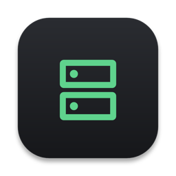
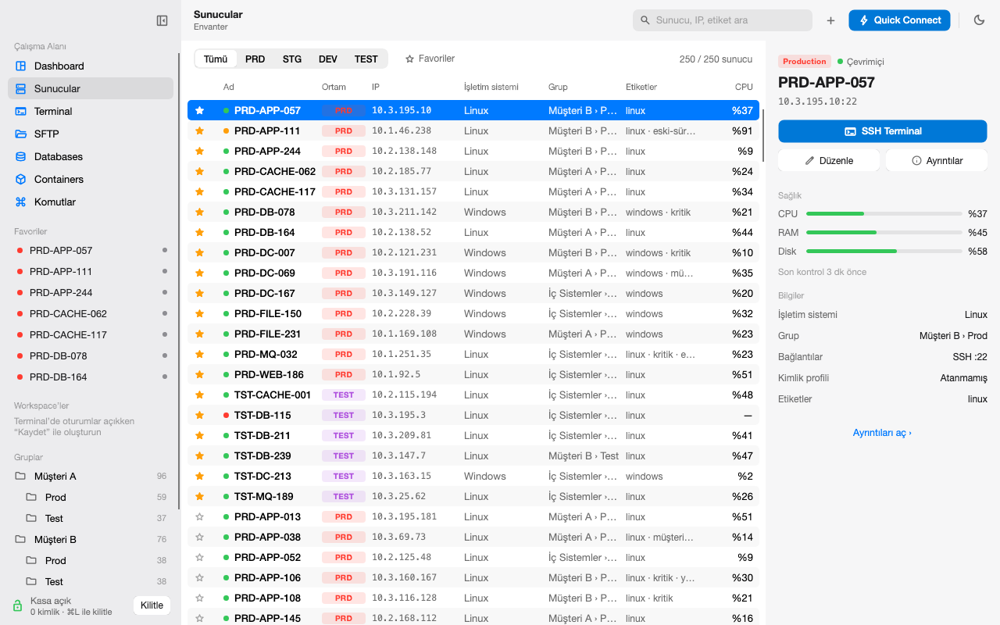
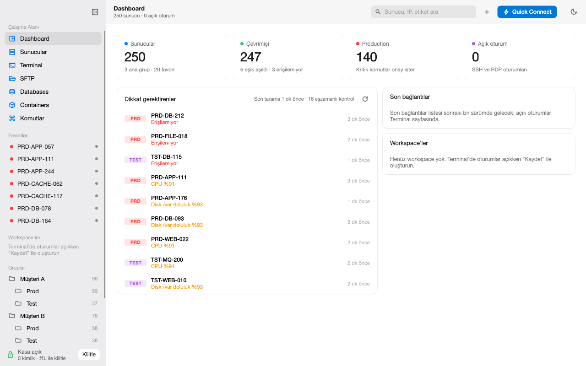
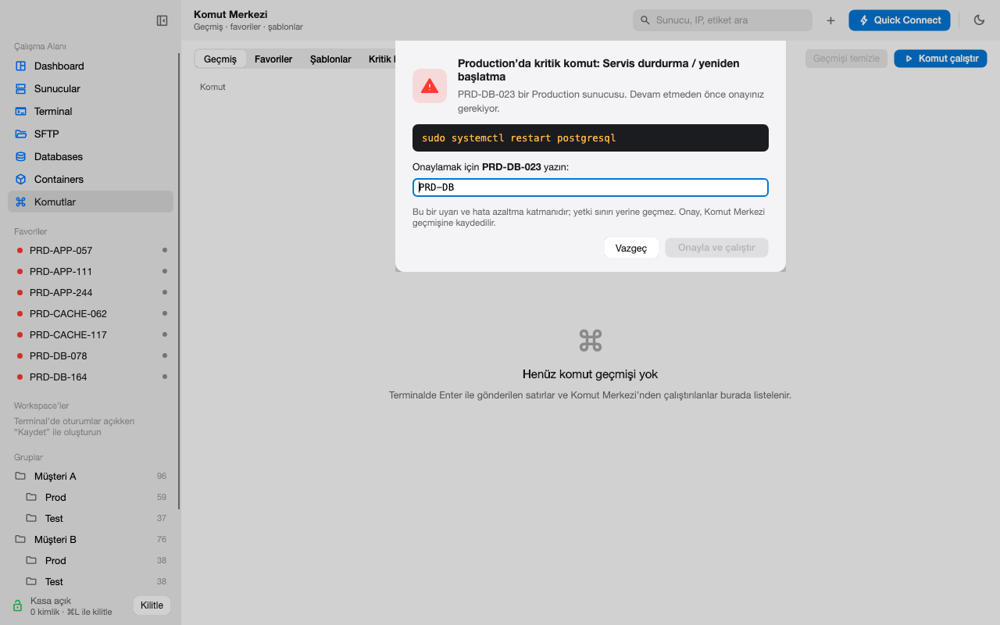
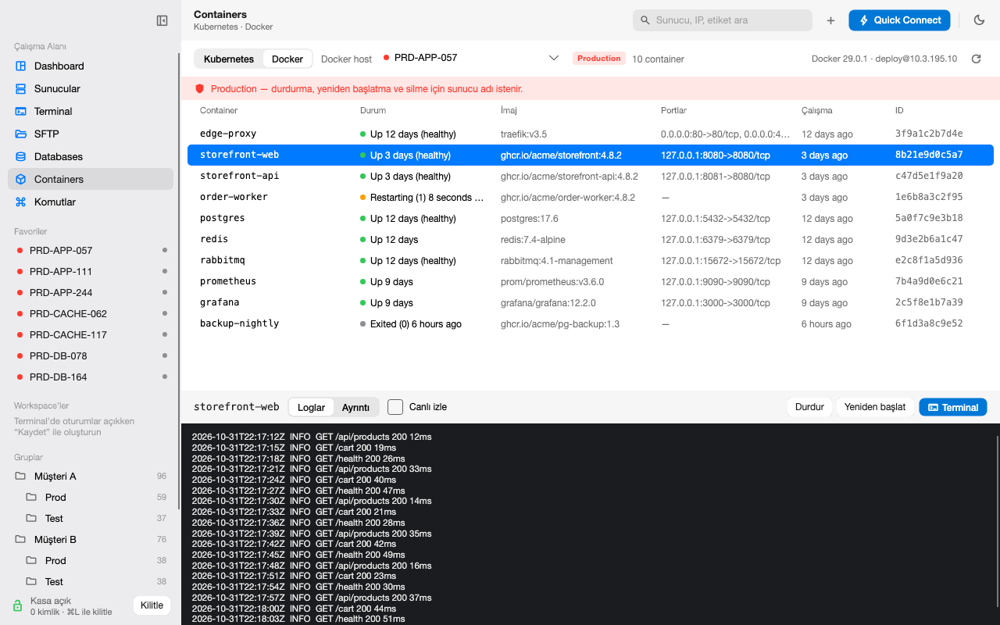
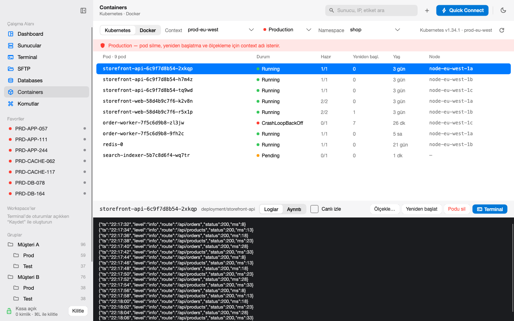

# ServerDesk

**Yönettiğin tüm sunucular için tek masa.** 
SSH, RDP, SFTP, veritabanları, Docker ve Kubernetes; macOS ve Windows için tek bir yerel uygulamada. Sırlar şifreli kasada, Production'da emniyet kemeri takılı.

 

&nbsp;

[Özellikler](#özellikler) · [Güvenlik](#güvenlik) · [Kurulum](#kurulum) · [Tüm sürümler](https://github.com/osmanarabaci/ServerDesk-releases/releases) · [English](README.md)

 

<picture>
  <source media="(prefers-color-scheme: dark)" srcset="docs/images/servers-dark.png">
  
</picture>

## Özellikler

| | |
|---|---|
| **Envanter** | Yüzlerce sunucu; gruplar, etiketler, favoriler, ortamlar (Production, Staging, Development, Test) ve anında arama. `~/.ssh/config` ya da CSV'den içe aktar, CSV'ye dışa aktar. |
| **Terminal** | Sekmelerde SSH oturumları, tam xterm terminali, bölünmüş görünüm ve kaydedip geri yükleyebileceğin workspace'ler. |
| **Uzak Masaüstü** | Paketle gelen FreeRDP ile yerleşik RDP oturumları. |
| **SFTP** | Sürükle-bırak destekli iki panelli dosya aktarımı. Her aktarım SHA-256 ve boyutla doğrulanır, çakışmalarda sorulur. |
| **Komut Merkezi** | Kayıtlı ve şablonlu komutları çalıştır, geçmişi tut, kritik komutları çalışmadan önce yakala. |
| **Sağlık** | SSH (Linux) ve WinRM (Windows) üzerinden ajansız CPU, RAM ve disk ölçümü; 24 saatlik geçmiş. |
| **Veritabanları** | SQL Server, PostgreSQL ve MySQL; doğrudan ya da SSH tüneliyle. Varsayılan olarak salt-okunur. |
| **Docker** | Herhangi bir SSH sunucusundaki container'lar: loglar, ayrıntılar, başlat, durdur, yeniden başlat, sil ve içeride kabuk. |
| **Kubernetes** | kubeconfig'deki context'ler: pod'lar, loglar, rollout restart, ölçekleme ve pod terminali. |
| **Hızlı kullanım** | Son bağlantılar, her sunucuda sağ tık menüsü, sekmeler, arama ve sunucu listesi için klavye kısayolları (<kbd>⌘/</kbd> hepsini gösterir). |

<table>
  <tr>
    <td width="50%">
      <picture>
        <source media="(prefers-color-scheme: dark)" srcset="docs/images/dashboard-dark.png">
        
      </picture>
      
<b>Pano</b>: ilgi bekleyenler tek bakışta

    </td>
    <td width="50%">
      <picture>
        <source media="(prefers-color-scheme: dark)" srcset="docs/images/critical-dark.png">
        
      </picture>
      
<b>Emniyet kemeri</b>: Production'da kritik komut için sunucu adını yaz

    </td>
  </tr>
  <tr>
    <td width="50%">
      <picture>
        <source media="(prefers-color-scheme: dark)" srcset="docs/images/docker-dark.png">
        
      </picture>
      
<b>Docker</b> SSH üzerinden, sunucuda ajan yok

    </td>
    <td width="50%">
      <picture>
        <source media="(prefers-color-scheme: dark)" srcset="docs/images/kubernetes-dark.png">
        
      </picture>
      
<b>Kubernetes</b> doğrudan kubeconfig'den

    </td>
  </tr>
</table>

## Güvenlik

- **Şifreli kasa.** Parolalar, SSH anahtarları ve passphrase'ler tek bir taşınabilir dosyada durur; Argon2id ile türetilen anahtar altında AES-256-GCM ile şifrelenir. Aynı kasa macOS'te ve Windows'ta açılır.
- **Kendiliğinden kilitlenir.** <kbd>⌘L</kbd> / <kbd>Ctrl+L</kbd> kasayı kilitler; bir süre işlem yapılmayınca, Mac uykuya geçince ya da ekran kilitlenince de kilitlenir. Kasa kilitliyken sır gerektiren hiçbir şey çalışmaz.
- **İlk kullanımda güven.** SSH host anahtarları, RDP sertifikaları ve veritabanı sertifikaları bir kez gösterilir ve kasaya sabitlenir. Değişen bir anahtar bağlantıyı durdurur ve nedenini söyler.
- **Production emniyet kemeri.** Kritik komutlar (`rm -rf`, `shutdown`, `systemctl restart`, `DROP`, …) ve Production sunucu, container ve cluster'lardaki yıkıcı işlemler önce sunucu adını yazmanı ister.
- **Varsayılan salt-okunur.** Veritabanı oturumları salt-okunur başlar; sen kapatana kadar değişiklikler geri alınır.

> [!NOTE]
> Bunlar uyarı ve hata azaltma katmanlarıdır; sunucuların kendi yetki denetiminin yerine geçmez.

## Kurulum

| Platform | Paket |
|---|---|
| macOS (Apple Silicon) | [`ServerDesk-osx-arm64-Setup.pkg`](https://github.com/osmanarabaci/ServerDesk-releases/releases/latest/download/ServerDesk-osx-arm64-Setup.pkg): `~/Applications` içine kurulur, yönetici parolası gerekmez |
| Windows 10/11 (x64) | [`ServerDesk-win-x64-Setup.exe`](https://github.com/osmanarabaci/ServerDesk-releases/releases/latest/download/ServerDesk-win-x64-Setup.exe) |

Taşınabilir `.zip` sürümleri her [sürüm sayfasında](https://github.com/osmanarabaci/ServerDesk-releases/releases/latest). Kurulduktan sonra ServerDesk bu sayfayı denetler ve kendini arka planda günceller; güncellemeler küçük delta paketlerdir.

> [!IMPORTANT]
> Paketler henüz kod imzalı değil. macOS'te `.pkg`'yi bir kez aç ve **Bitti**'yi seç (*Çöp Sepetine Taşı*'yı değil); ardından **Sistem Ayarları → Gizlilik ve Güvenlik**'te engellenen paketin yanındaki **Yine de Aç**'a bas. Windows'ta SmartScreen'de **Ek bilgi → Yine de çalıştır**'ı seç.

## Lisans

ServerDesk [MIT Lisansı](LICENSE) ile yayımlanır. Kurulum paketleri kendi lisanslarıyla gelen üçüncü taraf bileşenler içerir; liste her paketin içindeki `THIRD-PARTY-NOTICES` dosyasındadır. macOS paketi FreeRDP'nin Homebrew bağımlılıklarını içerir; bunların bir kısmı (ffmpeg, x264, x265) GPL lisanslıdır.

Ekran görüntülerindeki veriler uydurmadır.
